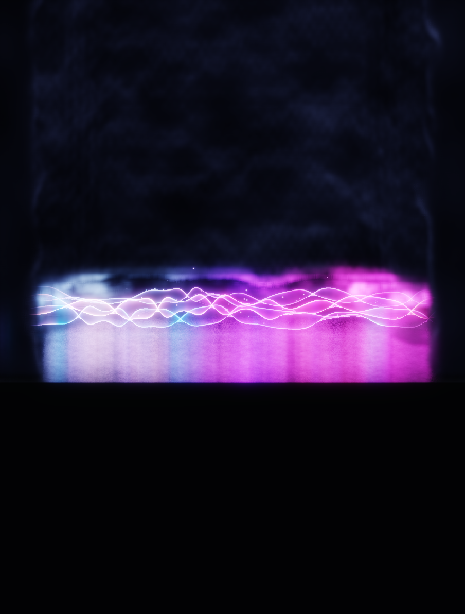

# Waveform Ribbon: rejected mist and replacement directions

**Status update, 3 November 2026: historical rejected-method analysis only.** The operator's *2 November* rejection applies to the **earlier shaped-bank/fringe and layered floor-haze approach captured below**, **not** the current unified atmosphere. The newer treatment is now considered a **good, improvable direction**, including its gentle tint from the luminous ribbon into the night mist. Preserve it unless a demonstrated defect justifies a local correction. Do not resurrect the hard-edged baked banks, box/ceiling, separate distance-floor haze or cloud banks; do not darken the whole scene or bleach it. See [`Waveform_Ribbon_Visual_Authority_20261103.md`](Waveform_Ribbon_Visual_Authority_20261103.md) and [`Waveform_Ribbon_Lab_Plan.md`](Waveform_Ribbon_Lab_Plan.md) for **live** constraints.

**Original 2 November diagnosis (retained for forensic comparison):** The operator rejected the *then-current* mist treatment. The requested direction was *Silent Hill at night*: fog filling the whole scene, displaced and softly lit by the actual moving waveform. The subsequent target is `references/Mist Goal.png`; all older shaped/floor haze mechanisms are superseded. The alternatives below document the old investigation. They do not override
the new image or constitute native acceptance.

The [unaltered capture receipt](Images/Waveform_Ribbon_Rejected_Mist_20261102.capture.json) records the exact source-file hashes and settings, including uncommitted state; `source_revision` alone is not the source identity. The image SHA-256 is `04dd5e0376926276b9dc3626d7ed13f53f8bd39dd98846c9a255e8f344bc9340`. This is a 904 × 1192 orthographic offline production-render capture at source time 20.009163 s, from the recorded Ragdoll clip; the receipt identifies its packet, aperture and source. It is a still, not native playback or audiovisual acceptance.

## Why it failed

The operator finds the fringe ugly and the treatment without value. The preserved view shows a large, conspicuous mass rising over the narrow waveform, a horizontal bright fringe and dark, bounded-looking sides; it does not read as a coherent atmosphere surrounding the scene. The still supports those visible observations; its appearance in motion, the exact source of every artefact and its actual runtime cost need separate measurement.

The implementation starts from a shaped band behind the ribbons, closes it using world-x side walls, and computes a bright edge around an envelope; those artistic assumptions predate the full-scene brief. A fixed-height/world-box shape bake, envelope table, side-wall rule, fringe lighting and screen-space filtering make it a shaped background effect with special treatment around its edge. Even though a separate sampled 3D tube clears mist around the sheets, that alone does not create the desired surrounding atmosphere. Smoothing existing taps did not change this premise. The ground-bank height/light are intentionally zero; do not restore volumetric ground banks. The former cheap analytic floor distance mist was separate, but the latest replacement direction supersedes it too.

At the time of the rejected capture the code allocated a shape bake, GPU envelope reduction, direct and reflected froxel volumes and reduced-resolution marches, plus composite/filter work. Outside the bake the shape may be evaluated analytically, including multiple sheet-distance samples. These are cost *mechanisms*, not measured savings from deleting them. One earlier loaded Game60 run of preset 2 reported median whole-mode render 14.03 ms and median CPU-side stages including envelope 3.88 ms, fog update 1.015 ms and fog march 0.859 ms ([run summary](../../.artifacts/evidence/waveform_ribbon/wr_live_game60_p2_profile_v1_20261102/summary.json)). It predates subsequent GPU-envelope changes, is not an isolated mist-on/off GPU comparison, and cannot establish the cost or savings of this rejected capture. Measure the replacement and removed owners on current source under the same native load.

## Historical replacement proposals (not the current implementation queue)

All alternatives use one world-space density field with no authored ceiling, side wall, cut-out stripe or camera-dependent fog translation. The physical, deformed and rolled sheet defines a soft three-dimensional exclusion; a fixed world point must sample the same field when the eye moves. The floor remains the admitted physical plane and extends through foreground into gradually obscured distance. Reuse infrastructure only when its measured behavior serves this contract; remove obsolete effect-specific owners after the replacement is admitted. Mist Off must retire all replacement work and resources.

1. **Bounded froxel atmosphere with a moving exclusion and wake — recommended prototype.** Fill a camera-frustum grid by sampling a continuous world density: distance-driven extinction, dark desaturated blue-grey night colour and low-frequency world-space variation. Carve a soft clearance from the actual three-sheet body and its analytic continuation. Add a bounded, decaying world-space wake from the body's recent motion, not a permanent empty stripe, and a restrained local colour/light response to the real musical passage and accents. Integrate once into scene transmittance and radiance so body, particles, floor and reflection see consistent fog. This keeps the full-scene look and gives a testable fixed upper bound on grid, light and march work; frustum reprojection, history rejection and reflection handling need explicit implementation and measurement.
2. **Analytic distance fog plus a small world-space reactive wake.** Evaluate a continuous depth-integrated base fog without a large simulated volume; overlay a bounded low-resolution world-space density/displacement field near the waveform. It offers a cheaper base and predictable distance obscuration, but coherent occlusion of moving foreground particles and reflections needs proof, and a planar overlay must not become another visible band.
3. **World-space clipmapped density volume.** Maintain a small set of bounded world-aligned volumes with smooth overlap and inject sheet motion/light into them. It can give persistent volumetric trails and consistent multi-angle sampling, but has the highest state, update and memory complexity; clipmap movement, reprojection and history expiry must not make fog slide or pop.

For all options, use smooth finite falloffs and world-continuous sampling, with no hard volume box visible at the horizon or above the camera. Use stable sampling and measured temporal filtering; avoid stationary screen-space noise, crawling fringe, ghost trails and sudden changes when sheet count, rotation or effect state changes. Particles and strands should be depth-occluded and softly lit by the same atmosphere, not hidden by an unrelated foreground overlay. Audio must affect meaningful local wake/light at accents and passage changes while quiet retains atmosphere; never fake reactivity by moving the whole camera or pulsing all fog uniformly.

## Evidence before admission

- Prototype the recommended option behind a distinct experimental owner; compare against fog off and preserve the rejected image as a negative control. Verify the same immutable body packet and clock drive body, clearance, fog, particles and reflection.
- For any new investigation, capture same-world-point and motion sequences in **Perspective only**, while orbiting, moving through the scene and rolling the sheets, including end-on, low, tall and wide views. Former Perspective/Orthographic toggling was an historical experimental gate and is retired. Test distant/far and overhead samples, count changes and Off/On transitions. Assert finite smooth clearance around the actual surface and no field jump at grid, bake, history or view boundaries.
- Use the existing pooled recorded PCM passages, with synchronized audio and quiet, sustained loud and distinct accents; compare wake/light against a fixed-body or silent control. Report input, clocks, camera, source hashes and native frame dimensions; inspect continuous motion rather than inferring it from stills.
- Measure current-source fog Off versus each prototype under matched native workload, viewport, camera and audio, including CPU preparation, GPU stages, allocations, memory and whole-frame median/tail. Include worst admitted view and reflection; distinguish a limited prototype result from the live budget gate.
- Operator reviews the native audiovisual result for the night-fog direction, full-scene coverage, reactivity and absence of ceiling, strip, grain, popping and world shift. No visual or performance gate closes from this write-up.
